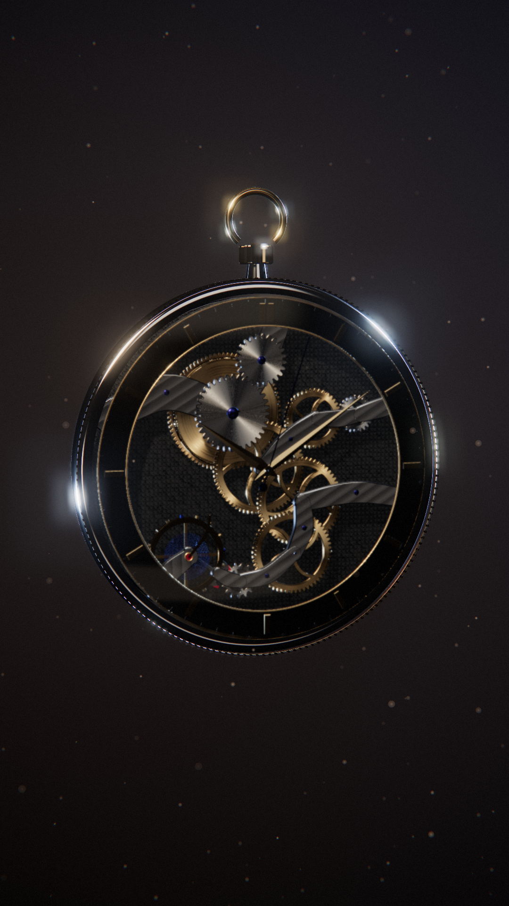
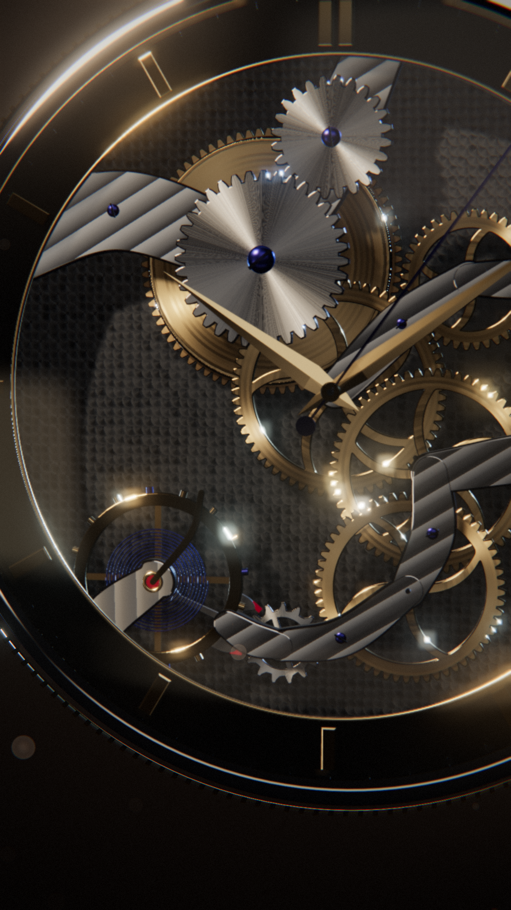
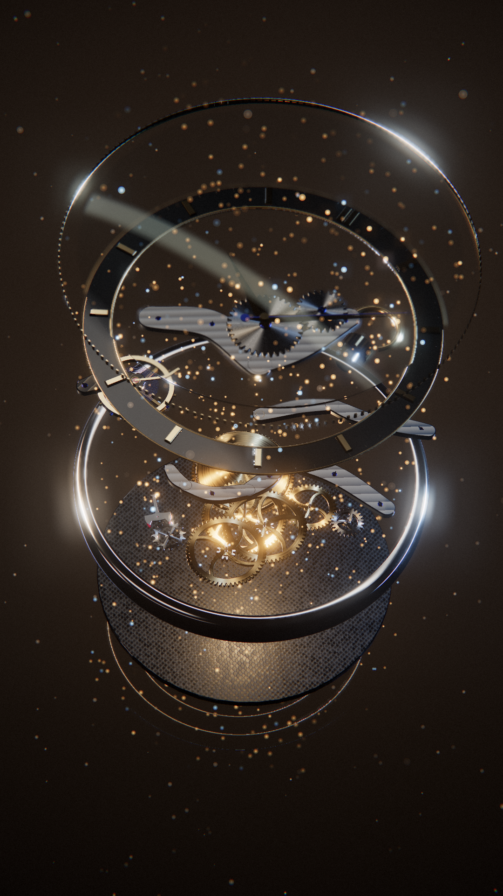
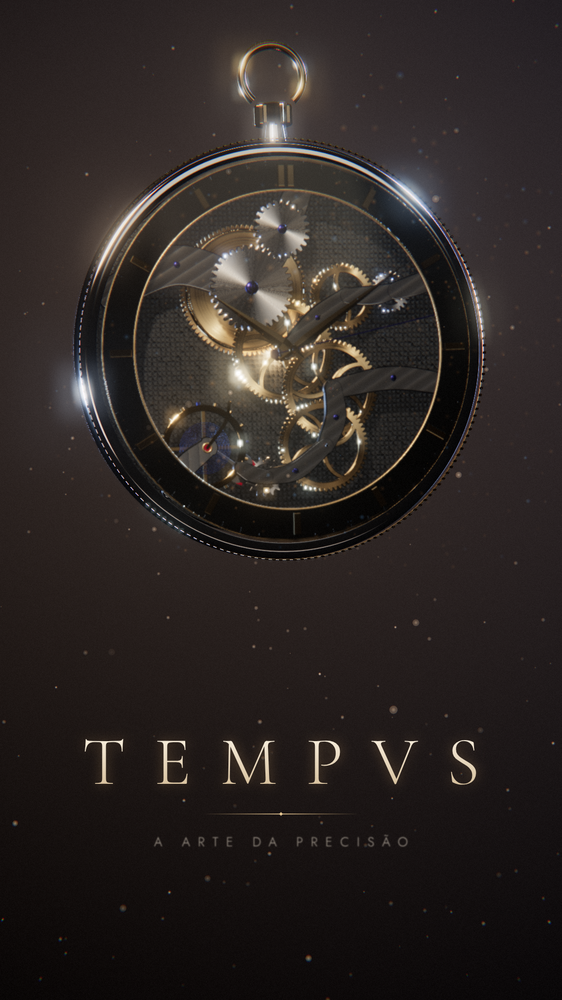

# TEMPVS — relógio mecânico flutuante (12 s, 1080×1920)

Animação cinematográfica 3D em tempo real feita com **Three.js (r169) + GLSL + GSAP 3.12**.
Um relógio de bolso mecânico flutua num estúdio escuro. A câmera se aproxima. O movimento se abre em camadas atravessadas por partículas luminosas e depois volta a se fechar, enquanto a câmera orbita e a tipografia aparece.

| 1 s | 4 s | 7 s | 11 s |
|---|---|---|---|
|  |  |  |  |

Vídeo: [`renders/tempvs_1080x1920.mp4`](renders/tempvs_1080x1920.mp4) (H.264, 30 fps, 360 quadros, renderização determinística).
O render mestre sai em CRF 15 (~95 MB, fora do git). O arquivo versionado é uma re-codificação CRF 21 (~12,6 MB).

## Executar

```bash
npm run serve           # ou qualquer servidor estático na raiz do projeto
# abrir http://localhost:8080/            (pré-visualização em 540×960, em loop)
# http://localhost:8080/?scale=1          (resolução cheia 1080×1920)
# Espaço = pausar/retomar
```

Não há etapa de build. `three` e `gsap` ficam em `vendor/` e são carregados por import map.

## Renderização determinística (stills e MP4)

Requer Node 18+, Playwright com Chromium e ffmpeg com libx264.

```bash
node tools/render.mjs stills 1 4 7 11 --dir final   # PNGs em renders/final/
node tools/render.mjs video --fps 30                 # renders/tempvs_1080x1920.mp4 (mestre CRF 15)
```

O script abre `index.html?capture` num Chromium headless (WebGL2 via SwiftShader). Para cada quadro `i`, ele chama `window.renderAt(i / fps)` e envia o PNG do canvas para o ffmpeg por pipe.
Tudo o que aparece é função pura de `t`:

- a timeline mestre do GSAP fica pausada e é posicionada com `seek(t)`;
- a cinemática das engrenagens, o balanço, o escape e os ponteiros são calculados a partir de `t`;
- as partículas usam sementes fixas (mulberry32) e são animadas na GPU a partir de `t`;
- o grão de filme usa o número do quadro como semente.

Por isso o resultado não depende da velocidade da máquina. Em CPU (SwiftShader) cada quadro 1080×1920 leva de 4 a 9 s.

## Estrutura

```
index.html            página e import map
src/main.js           renderer, ambiente de estúdio, luzes, pipeline de pós-processamento, timeline GSAP
src/clock.js          geometria procedural do relógio e cinemática do trem de engrenagens
src/finishes.js       acabamentos de relojoaria em shader (onBeforeCompile)
src/shaders.js        fundo, partículas (GLSL), profundidade de campo e grade final
src/typography.js     tipografia animada em canvas, composta no shader final
tools/render.mjs      captura determinística de quadros e MP4 (Playwright + ffmpeg)
assets/fonts/         Cormorant Garamond e Jost (SIL Open Font License, textos incluídos)
```

## Direção de arte e técnica

**Modelagem (100% procedural, nada de primitivas genéricas soltas)**
- Engrenagens com **perfil de dente evolvente real** (ângulo de pressão de 20°), raios curvos vazados com cantos arredondados (Chaikin), pinhões e eixos.
- O trem de engrenagens tem **fase correta**: cada par calcula o ângulo do parceiro (θb = φ + π + π/Nb − (Na/Nb)(θa − φ)), então os dentes engrenam sem se atravessar.
- Escapamento de âncora suíça: roda de escape com dentes "club", âncora com paletas de rubi, balanço com parafusos de regulagem e espiral (hairspring) azulada que "respira". O escape avança meio dente a cada batida, sincronizado com o balanço.
- Pontes curvas com chanfros, parafusos azulados com fenda, rubis em chatons de ouro, catraca e roda da coroa, ponteiros dauphine facetados, mostrador esqueletizado em laca preta, caixa torneada (Lathe), coroa serrilhada com alça e cristal de safira abaulado.

**Materiais PBR** (MeshPhysicalMaterial), com acabamentos de relojoaria calculados por pixel no shader:
- *côtes de Genève* nas pontes (normais em ondas);
- *perlage* na platina;
- graneado circular anisotrópico nas rodas;
- escovado *sunburst* na catraca;
- chanfros (*anglage*) espelhados detectados pela normal.

O cristal tem transmissão, IOR 1.6 e uma leve iridescência de tratamento antirreflexo. Os parafusos azulados também têm iridescência.

**Iluminação de estúdio:**
- key light quente (spot com sombras PCF suaves);
- dois rim lights azuis;
- ambiente HDR gerado na hora a partir de *lightformers* (softboxes com bordas suaves → PMREM), o que mantém os reflexos controlados;
- luz interna quente durante a separação das camadas.

**Pós-processamento (pipeline próprio em HDR half-float):**
1. cena com MSAA 4× e depth texture;
2. **profundidade de campo bokeh em passe único** (espiral de ângulo áureo, scatter-as-gather);
3. partículas com *soft-depth* contra a cena e CoC próprio, que vira disco de bokeh fora de foco;
4. UnrealBloom;
5. passe final: tone mapping ACES, split-toning (sombras frias, altas luzes quentes), vinheta, aberração cromática lateral, tipografia e grão.

**Storyboard (timeline GSAP):**
- **0–4 s:** fade-in e aproximação lenta em direção ao escapamento, com o desfoque aumentando no close.
- **4–8 s:** o relógio se inclina e as 9 camadas se separam ao longo do eixo com stagger. A *yaw* é compensada para o eixo da explosão ficar vertical no quadro 9:16. As camadas flutuam em fases próprias (parallax). Um fluxo helicoidal de partículas atravessa o mecanismo.
- **8–12 s:** as camadas externas fecham primeiro e o conjunto se une com um pulso de partículas. A câmera orbita, e o título "TEMPVS" aparece letra a letra (subida, tracking e desfoque → nitidez), seguido do filete e da linha "A ARTE DA PRECISÃO".

## Licenças

- three.js: MIT (`vendor/three/LICENSE`).
- GSAP 3.12.5: licença padrão da GreenSock (uso gratuito, cabeçalho preservado em `vendor/gsap/gsap.min.js`).
- Fontes: SIL OFL 1.1 (`assets/fonts/OFL-*.txt`).

Não há outros assets externos: geometria, ambiente HDR e texturas são todos procedurais. O download de HDRIs do Poly Haven estava bloqueado na rede deste ambiente.
